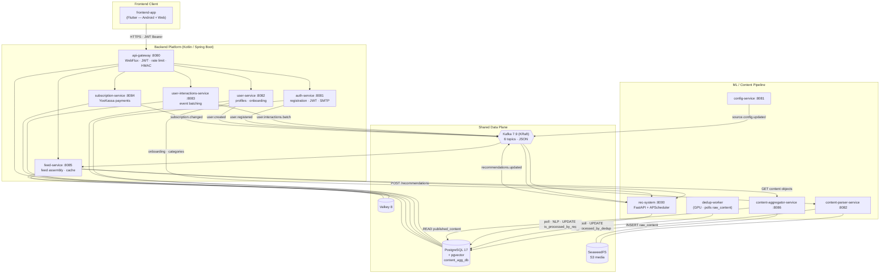

# SKD — платформа агрегации контента и персональной ленты

Пет-проект: платформа собирает посты из внешних источников (Telegram-каналы, веб-фиды), находит почти-дубликаты на эмбеддингах, обогащает контент NLP-признаками, строит профили интересов пользователя и отдаёт персональную ленту во Flutter-клиент. Пять независимых подсистем в одном монорепо: контент-пайплайн на Kotlin, два Python-сервиса с ML, платформа из шести микросервисов и мобильный клиент. Общая плоскость данных одна: PostgreSQL 17 с pgvector, Kafka, Valkey, SeaweedFS.

## Архитектура



Ключевые правила, которые держат систему целой: клиент ходит только в шлюз, каждый сервис пишет только в свои таблицы, топики Kafka версионированы, сквозной UUID пользователя проходит от авторизации до рекомендаций, внутренние сервисы принимают запросы только с HMAC-подписью шлюза.

## Подсистемы

| Подсистема | Стек | Ответственность |
|---|---|---|
| content-aggregation-system | Kotlin, Spring Boot 3.4 | конфигурация источников, парсинг Telegram и веба, публикация контента через REST |
| dedup-system | Python 3.12 | GPU-воркер: поиск почти-дубликатов по эмбеддингам, граф похожестей |
| rec-system | Python 3.12, FastAPI | NLP-признаки, профили интересов, ранжирование ленты |
| backend | Kotlin, Spring Boot 3.4, 6 микросервисов | шлюз API, авторизация, профили, события, подписки, сборка ленты |
| frontend-app | Dart 3, Flutter 3 | клиент Android + Web: регистрация, онбординг, лента, коллекции |

## Что здесь интересного

- Шлюз на Spring WebFlux: JWT с отзывом токенов и rate limiting через Valkey, HMAC-подпись `X-Gateway-Signature`, за шлюзом внутренние сервисы наружу не торчат.
- Kafka 7.9 в KRaft-режиме без Zookeeper: семь топиков, JSON в бэкенде и Protobuf в контент-пайплайне, transactional outbox в сервисах авторизации, пользователей и подписок.
- PostgreSQL 17 + pgvector с HNSW-индексами: эмбеддинги живут в БД, бенчмарк индекса в `scripts/hnsw_demo` (замеры до/после). Каждая подсистема владеет своей схемой и чужого не пишет, таблица взаимодействий партиционирована помесячно.
- Дедупликация на GPU: BGE-M3 FP16 (1024-dim), точное сравнение по SHA-256 плюс пороговый классификатор EXACT / DUPLICATE / RELATED, результат — граф похожестей, на который опирается рекомендер.
- Рекомендации на rubert-tiny2 (312-dim) с тематикой, тональностью и NER: профиль интересов пересчитывается по потоку событий из Kafka, ответ ранкера содержит разбивку скоринга по компонентам — видно, почему пост попал в ленту.
- Наблюдаемость: Prometheus-метрики со всех сервисов, структурные JSON-логи с `request_id` и `user_id`; шлюз выпускает `X-Request-Id` на каждый запрос и протаскивает его через всю цепочку вызовов.
- Тесты: около 630 автотестов в ML-подсистемах (dedup ~180, rec-system ~450) на Testcontainers, бэкенд под JUnit 5 + MockK + Testcontainers, во Flutter widget- и unit-тесты с golden-сравнением экранов.
- Деплой: полный стек поднимается одним `docker compose up -d` (инфраструктура, миграции Liquibase/Alembic, 11 сервисов), для Kubernetes есть манифесты под k3d/k3s с миграциями в виде Job.

## Запуск

Нужны Docker с Compose-плагином и примерно 8 ГБ свободной памяти. Скопируйте переменные окружения и поднимайте стек:

```bash
cp backend/.env.example .env   # заполнить SMTP/платёжные переменные при необходимости
docker compose up -d
```

Варианты попроще: `docker-compose.ml.yml` (только ML-пайплайн) и `docker-compose.smoke.yml` (минимальный смоук-стек). Манифесты Kubernetes лежат в `infrastructure/k8s/`, подробности деплоя и e2e-тест конвейера данных описаны в [docs/README.en.md](docs/README.en.md).

## Структура репозитория

```
skd-content-platform/
├── backend/                    # 6 микросервисов Kotlin/Spring Boot
├── content-aggregation-system/ # контент-пайплайн (config, parser, aggregator)
├── dedup-system/               # GPU-воркер дедупликации
├── rec-system/                 # рекомендательный сервис FastAPI
├── frontend-app/               # Flutter-клиент (Android + Web)
├── infrastructure/             # k8s-манифесты, gateway, postgres, seaweedfs
├── scripts/                    # сиды источников, миграции, e2e-тест, hnsw_demo
├── docs/                       # подробный README на английском
├── docker-compose.yml          # полный стек
└── data-capture-spec.md        # спецификация сквозной интеграции
```

Подробное техническое описание: архитектурные правила, владение таблицами, топики Kafka, потоки данных и модель разработки — в [docs/README.en.md](docs/README.en.md).
